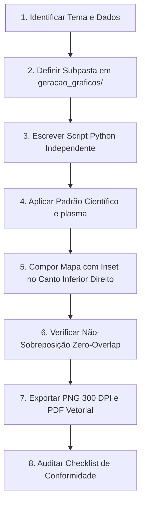

# Diretriz 03: Checklist e Protocolo de Ação para Agentes

Todo agente de IA ou desenvolvedor deve executar este protocolo de verificação antes de considerar qualquer tarefa de geração de figuras ou mapas como concluída.

---

## 1. Protocolo de Ação Passo a Passo

---

## 2. Checklist Obrigatório de Conformidade

Antes de finalizar qualquer modificação ou entrega, verifique os 8 itens fundamentais:

### [ ] 1. Idioma e Terminologia (100% Inglês)
- [ ] Todos os títulos, rótulos de eixos (`X`, `Y`), unidades e legendas estão em inglês?
- [ ] A barra de cor está rotulada em inglês (ex.: `Elevation (m)`, `Population Density (people/km²)`)?
- [ ] A escala está em inglês (ex.: `500 km`, não `500 quilômetros`)?
- [ ] Foram eliminados termos residuais em português ou caracteres orientais indesejados (como os vistos no Anexo 2: `（16713 amostras）`)?

### [ ] 2. Mapa de Cores Padronizado (`plasma`)
- [ ] O mapa de cores para dados contínuos/escalares é estritamente `'plasma'`?
- [ ] Caso haja ordens de grandeza (como densidade populacional ou microplásticos), foi utilizada normalização logarítmica (`LogNorm`)?
- [ ] Áreas sem dados, massas de terra não estudadas ou oceanos possuem cores neutras e não concorrem com a escala de cores principal?

### [ ] 3. Composição de Mapas, Inset no Canto Inferior Esquerdo e Escala Vertical à Direita
- [ ] O mapa principal é o recorte ampliado (zoom) da região de estudo com alto nível de detalhe?
- [ ] O mapa-múndi localizador (inset) está posicionado **no canto inferior esquerdo (`lower left`)**?
- [ ] A barra de cores / escala (`colorbar`) está **em pé à direita (`vertical`, `right`)**?
- [ ] O mapa-múndi está inteiramente em **tons de cinza** (`fc='#d0d0d0'`, `ec='#909090'`)?
- [ ] Há um retângulo de delimitação nítido sobre o mapa-múndi indicando exatamente onde o zoom foi aplicado?
- [ ] **Foram eliminadas todas as linhas tracejadas diagonais (`ConnectionPatch`) que ligavam painéis diferentes?**

### [ ] 4. Qualidade e Resolução do Mapa-Múndi (Sem Pixelização)
- [ ] O mapa-múndi foi construído com polígonos vetoriais limpos (usando `diretrizes/assets/world_land_110m.geojson`)?
- [ ] Foram evitadas matrizes rasterizadas de baixa resolução com blocos ou "tijolos" quadrados (erro do Anexo 2)?
- [ ] As linhas de costa do mapa-múndi aparecem contínuas, suaves e bem delineadas?

### [ ] 5. Regra da Não-Sobreposição (Zero-Overlap)
- [ ] Os identificadores de subpainéis `(a)`, `(b)`, `(c)` estão livres de qualquer linha, dado ou borda sobreposta?
- [ ] As linhas conectoras ou bordas de gráficos não cortam pontos de dados, fozes de rios ou costas (erro do Anexo 1)?
- [ ] Legendas e barras de escala estão posicionadas em áreas marítimas ou zonas vazias com margem adequada?
- [ ] Rótulos de latitude e longitude não colidem com o mapa-múndi inset nem com as barras de escala?

### [ ] 6. Organização e Localização de Arquivos
- [ ] A figura está alocada na pasta correta dentro de `geracao_graficos/<tema>/`?
- [ ] A subpasta possui um nome temático claro (`gebco`, `noaa`, `watherSeads`, `populacao`, etc.)?
- [ ] Na pasta constam **tanto** o script Python gerador quanto a própria imagem gerada?
- [ ] A imagem foi salva em ambos os formatos: `.png` (alta resolução, ≥ 300 DPI) e `.pdf` (vetorial)?

### [ ] 7. Reprodutibilidade e Autonomia do Código
- [ ] O script de geração roda de ponta a ponta sem erros a partir da linha de comando (`python <script>.py`)?
- [ ] O script localiza os dados de entrada usando caminhos relativos robustos (`REPO_ROOT`) e não depende de caminhos absolutos locais específicos do usuário?
- [ ] Sementes aleatórias ou parâmetros numéricos foram fixados?

### [ ] 8. Atualização da Documentação
- [ ] O catálogo em `geracao_graficos/README.md` foi atualizado com a nova figura, script e descrição?
